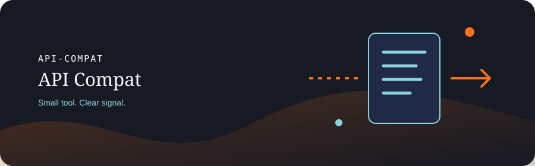

<div align="center">



# API Compat

**A focused OpenAPI 3 JSON compatibility checker for release reviews.**

[](https://www.python.org/) [](LICENSE)

</div>

## Why it exists

Catch contract changes that can break clients before they ship. Compares OpenAPI JSON documents and detects removed paths or methods, removed parameters, newly required parameters and selected response-schema changes. YAML, reference resolution and full JSON Schema compatibility are not implemented.

## Features

- Removed endpoint and method detection
- Parameter removal and newly-required checks
- Top-level response property checks
- Non-zero exit when supported breaking changes are found

## Quick start

Python 3.10+; no third-party packages.

```bash
git clone https://github.com/MofidChallenge10/api-compat.git
cd api-compat
python tool.py --help
```

### Example

```bash
python tool.py old-openapi.json new-openapi.json
```

## Self-test

```bash
python tool.py --self-test
```

The self-test uses the standard-library `unittest` module and does not contact external services.

## Scope and safety

Compares OpenAPI JSON documents and detects removed paths or methods, removed parameters, newly required parameters and selected response-schema changes. YAML, reference resolution and full JSON Schema compatibility are not implemented. Review output before using it in production workflows.

## Design notes

The illustration is an original lightweight SVG. Its motion is decorative only and respects `prefers-reduced-motion`; the CLI itself stays plain and pipe-friendly.

## Contributing

Issues and pull requests are welcome. Keep the standard-library-first approach, add focused tests for behavior changes, and update examples when options change.

## License

MIT — see [LICENSE](LICENSE).
